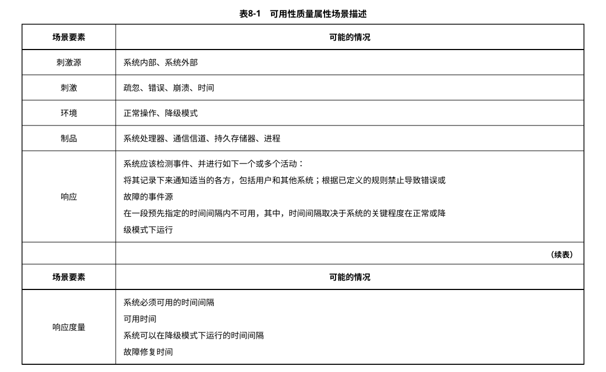
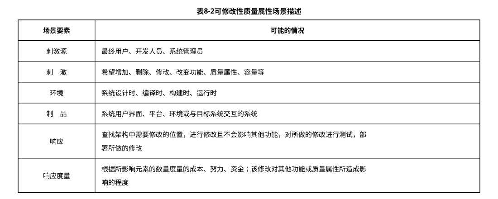
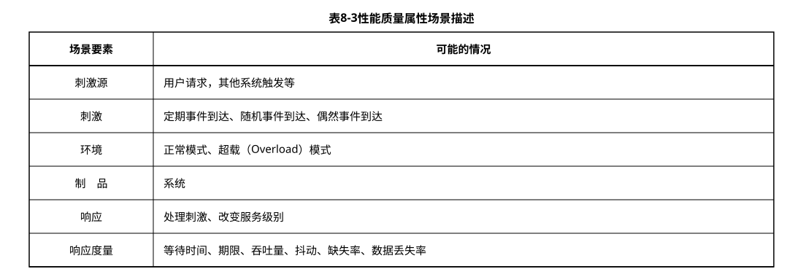
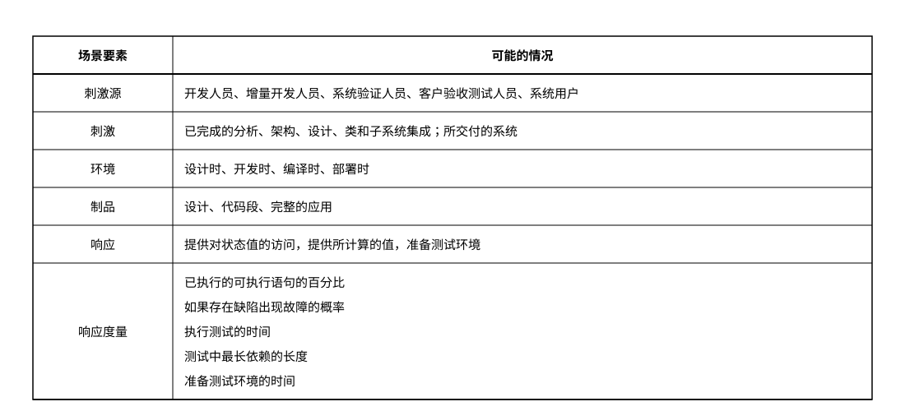
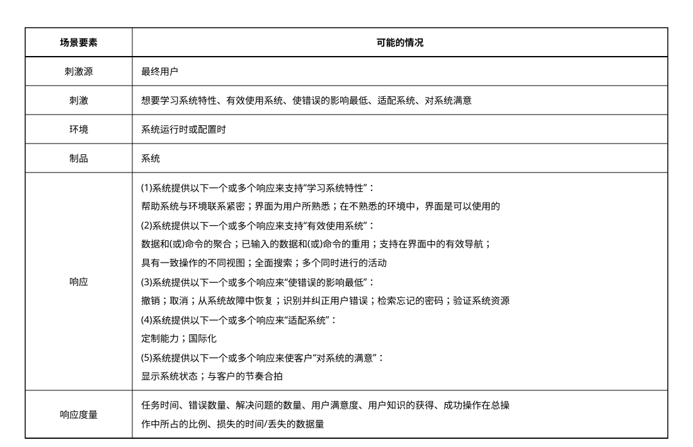
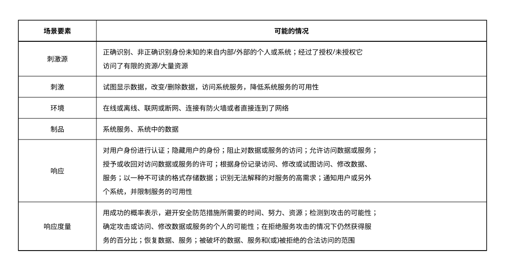

# 8.1 软件系统质量属性

## 8.1.1 质量属性概念

软件系统的质量就是“软件系统与明确地和隐含地定义的需求相一致的程度”。更具体地说，软件系统质量是软件与明确地叙述的功能和性能需求文档中明确描述的开发标准以及任何专业开发的软件产品都应该具有的隐含特征相一致的程度。根据 `GB/T 16260.1` 定义，从管理角度对软件系统质量进行度量，可将影响软件质量的主要因素划分为 6 种维度特性：功能性、可靠性、易用性、效率、维护性与可移植性。其中功能性包括适合性、准确性、互操作性、依从性、安全性；可靠性包括容错性、易恢复性、成熟性；易用性包括易学性、易理解性、易操作性；效率包括资源特性和时间特性；维护性包括可测试性、可修改性、稳定性和易分析性；可移植性包括适应性、易安装性、一致性和可替换性。

软件系统质量属性(`Quality Attribute`)是一个系统的可测量或者可测试的属性，用来描述系统满足利益相关者(`Stakeholders`)需求的程度。基于软件系统的生命周期，可以将软件系统的质量属性分为开发期质量属性和运行期质量属性2个部分。

### 1. 开发期质量属性

开发期质量属性主要指在软件开发阶段所关注的质量属性，主要包含 6 个方面。

1. 易理解性：指设计被开发人员理解的难易程度。
2. 可扩展性：软件因适应新需求或需求变化而增加新功能的能力，也称为灵活性。
3. 可重用性：指重用软件系统或某一部分的难易程度。
4. 可测试性：对软件测试以证明其满足需求规范的难易程度。
5. 可维护性：当需要修改缺陷、增加功能、提高质量属性时，识别修改点并实施修改的难易程度。
6. 可移植性：将软件系统从一个运行环境转移到另一个不同的运行环境的难易程度。

### 2. 运行期质量属性

运行期质量属性主要指在软件运行阶段所关注的质量属性，主要包含 7 个方面。

1. 性能：性能是指软件系统及时提供相应服务的能力，如速度、吞吐量和容量等的要求。
2. 安全性：指软件系统同时兼顾向合法用户提供服务，以及阻止非授权使用的能力。
3. 可伸缩性：指当用户数和数据量增加时，软件系统维持高服务质量的能力。例如，通过增加服务器来提高能力。
4. 互操作性：指本软件系统与其他系统交换数据和相互调用服务的难易程度。
5. 可靠性：软件系统在一定的时间内持续无故障运行的能力。
6. 可用性：指系统在一定时间内正常工作的时间所占的比例。可用性会受到系统错误，恶意攻击，高负载等问题的影响。
7. 鲁棒性：是指软件系统在非正常情况(如用户进行了非法操作、相关的软硬件系统发生了故障等)下仍能够正常运行的能力，也称健壮性或容错性。

## 8.1.2 面向架构评估的质量属性

为了评价一个软件系统，特别是软件系统的架构，需要进行架构评估。在架构评估过程中，评估人员所关注的是系统的质量属性。评估方法所普遍关注的质量属性有以下几种。

### 1. 性能

性能(`Performance`)是指系统的响应能力，即要经过多长时间才能对某个事件做出响应，或者在某段事件内系统所能处理的事件的个数。经常用单位时间内所处理事务的数量或系统完成某个事务处理所需的时间来对性能进行定量表示。性能测试经常要使用基准测试程序。

### 2. 可靠性

可靠性(`Reliability`)是软件系统在应用或系统错误面前，在意外或错误使用的情况下维持软件系统的功能特性的基本能力。可靠性是最重要的软件特性，通常用来衡量在规定的条件和时间内，软件完成规定功能的能力。可靠性通常用平均失效等待时间(`Mean Time To Failure`，`MTTF`)和平均失效间隔时间(`Mean Time Between Failure`，`MTBF`)来衡量。在失效率为常数和修复时间很短的情况下，`MTTF` 和 `MTBF` 几乎相等。可靠性可以分为两个方面。

1. 容错。容错的目的是在错误发生时确保系统正确的行为，并进行内部“修复”。例如在一个分布式软件系统中失去了一个与远程构件的连接，接下来恢复了连接。在修复这样的错误之后，软件系统可以重新或重复执行进程间的操作，直到错误再次发生。
2. 健壮性。这里说的是保护应用程序不受错误使用和错误输入的影响，在发生意外错误事件时确保应用系统处于预先定义好的状态。值得注意的是，和容错相比，健壮性并不是说在错误发生时软件可以继续运行，它只能保证软件按照某种已经定义好的方式终止执行。软件架构对软件系统的可靠性有巨大的影响。例如，软件架构设计上通过在应用程序内部采用冗余机制，或集成监控构件和异常处理，以提升系统可靠性。

### 3. 可用性

可用性(`Availability`)是系统能够正常运行的时间比例。经常用两次故障之间的时间长度或在出现故障时系统能够恢复正常的速度来表示。

### 4. 安全性

安全性(`Security`)是指系统在向合法用户提供服务的同时能够阻止非授权用户使用的企图或拒绝服务的能力。安全性可根据系统可能受到的安全威胁类型来分类。安全性又可划分为机密性、完整性、不可否认性及可控性等特性。其中，机密性保证信息不泄露给未授权的用户、实体或过程；完整性保证信息的完整和准确，防止信息被非法修改；不可否认性是指信息交换的双方不能否认其在交换过程中发送信息或接收信息的行为；可控性保证对信息的传播及内容具有控制的能力，防止为非法者所用。

### 5. 可修改性

可修改性(`Modifability`)是指能够快速地以较高的性价比对系统进行变更的能力。通常以某些具体的变更为基准，通过考查这些变更的代价来衡量可修改性。可修改性包含以下 4 个方面。

1. 可维护性(`Maintainability`)。这主要体现在问题的修复上，在错误发生后“修复”软件系统。可维护性好的软件架构往往能做局部性的修改并能使对其他构件的负面影响最小化。
2. 可扩展性(`Extendibility`)。这一点关注的是使用新特性来扩展软件系统，以及使用改进版本方式替换构件并删除不需要或不必要的特性和构件。为了实现可扩展性，软件系统需要松散耦合的构件。其目标是实现一种架构，能使开发人员在不影响构件客户的情况下替换构件。支持把新构件集成到现有的架构中也是必要的。
3. 结构重组(`Reassemble`)。这一点处理的是重新组织软件系统的构件及构件间的关系，例如通过将构件移动到一个不同的子系统而改变它的位置。为了支持结构重组，软件系统需要精心设计构件之间的关系。理想情况下，它们允许开发人员在不影响实现的主体部分的情况下灵活地配置构件。
4. 可移植性(`Portability`)。可移植性使软件系统适用于多种硬件平台、用户界面、操作系统、编程语言或编译器。为了实现可移植，需要按照硬件、软件无关的方式组织软件系统。可移植性是系统能够在不同计算环境下运行的能力，这些环境可能是硬件、软件，也可能是两者的结合。如果移植到新的系统需要做适当更改，则该可移植性就是一种特殊的可修改性。

### 6. 功能性

功能性(`Functionality`)是系统能完成所期望的工作的能力。一项任务的完成需要系统中许多或大多数构件的相互协作。

### 7. 可变性

可变性(`Changeability`)是指架构经扩充或变更而成为新架构的能力。这种新架构应该符合预先定义的规则，在某些具体方面不同于原有的架构。当要将某个架构作为一系列相关产品(例如，软件产品线)的基础时，可变性是很重要的。

### 8. 互操作性

作为系统组成部分的软件不是独立存在的，通常与其他系统或自身环境相互作用。为了支持互操作性，软件架构必须为外部可视的功能特性和数据结构提供精心设计的软件入口。程序和用其他编程语言编写的软件系统的交互作用就是互操作性的问题，这种互操作性也影响应用的软件架构。

## 8.1.3 质量属性场景描述

为了精确描述软件系统的质量属性，通常采用质量属性场景(`Quality Attribute Scenario`)作为描述质量属性的手段。质量属性场景是一个具体的质量属性需求，是利益相关者与系统的交互的简短陈述。

质量属性场景是一种面向特定质量属性的需求。它由 6 部分组成：

- 刺激源(`Source`)：这是某个生成该刺激的实体(人、计算机系统或者任何其他刺激器)。
- 刺激(`Stimulus`)：该刺激是当刺激到达系统时需要考虑的条件。
- 环境(`Environment`)：该刺激在某些条件内发生。当激励发生时，系统可能处于过载、运行或者其他情况。
- 制品(`Artifact`)：某个制品被激励。这可能是整个系统，也可能是系统的一部分。
- 响应(`Response`)：该响应是在激励到达后所采取的行动。
- 响应度量(`Measurement`)：当响应发生时，应当能够以某种方式对其进行度量，以对需求进行测试。

质量属性场景主要关注可用性、可修改性、性能、可测试性、易用性和安全性等 6 类质量属性，下面分别列表进行介绍。

### 1. 可用性质量属性场景

可用性质量属性场景所关注的方面包括系统故障发生的频率、出现故障时会发生什么情况、允许系统有多长是非正常运行、什么时候可以安全地出现故障、如何防止故障的发生以及发生故障时要求进行哪种通知，表8-1给出了详细描述。

> 表 8-1 可用性质量属性场景描述

### 2. 可修改性质量属性场景

可修改性质量属性场景主要关注系统在改变功能、质量属性时需要付出的成本和难度，可修改性质量属性场景可能发生在系统设计、编译、构建、运行等多种情况和环境下，表8-2给出了详细描述。

> 表 8-2 可修改性质量属性场景描述

### 3. 性能质量属性场景

性能质量属性场景主要关注系统的响应速度，可以通过效率、响应时间、吞吐量、负载来客观评价性能的好坏，表8-3给出了详细描述。

> 表 8-3 性能质量属性场景描述

### 4. 可测试性质量属性场景

可测试性质量属性场景主要关注系统测试过程中的效率，发现系统缺陷或故障的难易程度等，表8-4给出了详细描述。

> 表 8-4 可测试性质量属性场景描述

### 5. 易用性质量属性场景

易用性质量属性场景主要关注用户在使用系统时的容易程度，包括系统的学习曲线、完成操作的效率、对系统使用过程的满意程度等，表8-5给出了详细描述。

> 表 8-5 易用性质量属性场景描述

### 6. 安全性质量属性场景

安全性质量属性场景主要关注系统在安全性方面的要素，衡量系统在向合法用户提供服务的同时，阻止非授权用户使用的能力，表8-6给出了详细描述。

> 表 8-6 安全性质量属性场景描述
